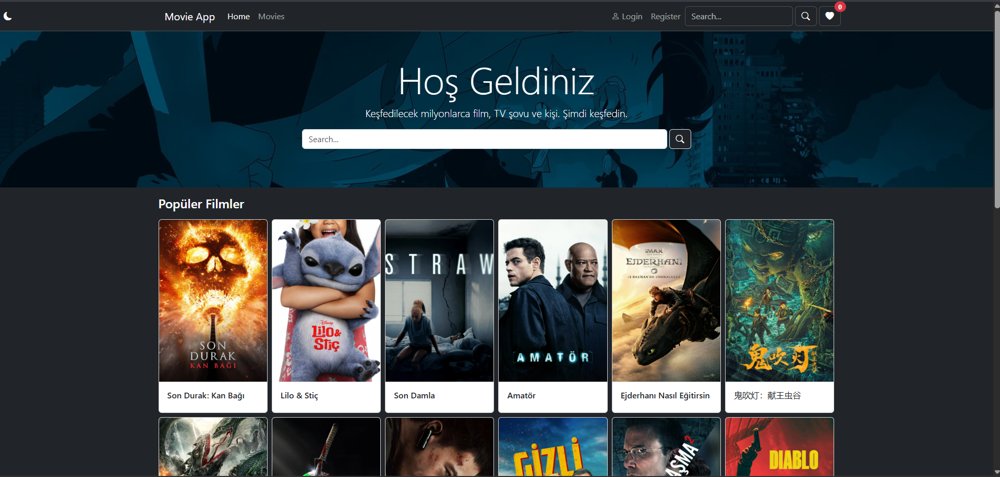
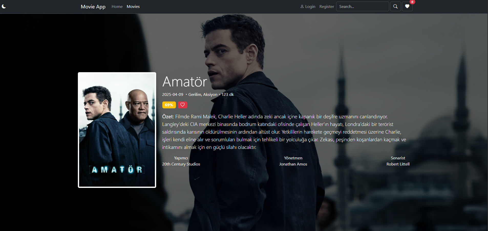
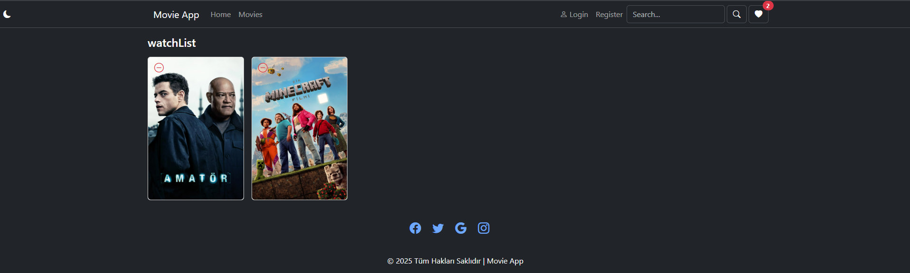

# 🎬 Movie App

Movie Explorer is a React-based web application that allows users to search movies, view detailed information, and manage a personal watchlist using TheMovieDB API.

## 🖼️ Preview

## 🚀 Features

- Movie search with real-time results
- Detailed movie pages with title, description, and images
- Add/remove movies from a personal watchlist
- Form handling for login and register pages
- Routing with React Router (multi-page layout)
- Global state management with Context API
- Loading spinner during API requests
- Error message handling
- Responsive UI using Bootstrap + CSS

## 🛠️ Built With

- React.js
- React Router DOM
- Context API
- Bootstrap
- CSS
- TheMovieDB API
- useState, useEffect
- Functional components

Last updated: 2026-10-27 23:21 UTC
